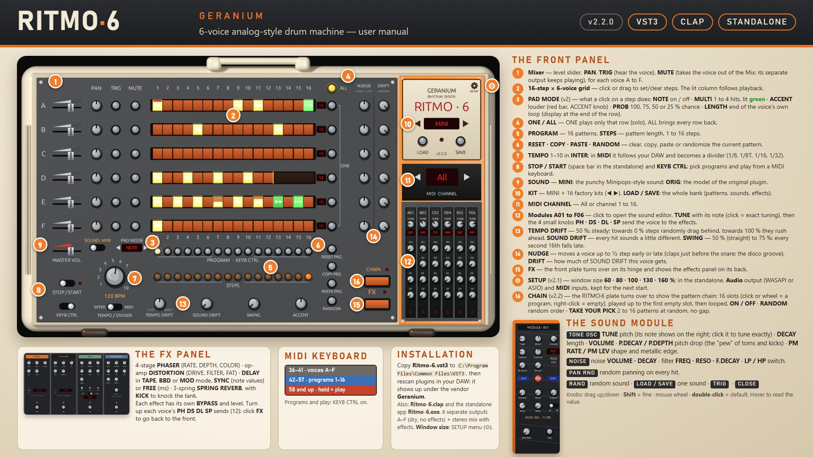

# Ritmo-6 — by Geranium

**Free 6-voice analog-style drum machine — VST3 · CLAP · standalone (Windows 64-bit)**
*Boîte à rythmes analogique 6 voix, gratuite — VST3 · CLAP · autonome (Windows 64 bits)*

**Version 2.2.0** · [Download / Télécharger](../../releases/latest)



*Mode d'emploi en français : [manual/mode-emploi-ritmo6.png](manual/mode-emploi-ritmo6.png)*

## What's new in 2.2 / Nouveautés de la 2.2
- **CHAIN**: the button above FX turns the RITMO·6 plate over. Behind it, a **pattern chain** of 16 slots (click or
  mouse wheel to put a program in a slot, right-click to empty it). With **ON / OFF** lit, the chained programs play
  one after another, from the first slot up to the first empty one, then again. **RANDOM** plays them in random
  order (never the same twice in a row); **TAKE YOUR PICK** fills the chain with 2 to 16 patterns drawn at random,
  with no gap. In host sync the chain keeps its place after a loop or a jump. Saved with projects and banks.
- **ASIO** in the standalone app (SETUP ▸ Audio ▸ Driver), besides WASAPI; 16- and 32-bit cards are supported.

*Le bouton **CHAIN** (au-dessus de FX) fait basculer la plaque RITMO·6 : derrière, une **chaîne de motifs** de 16 cases
(clic ou molette = un programme, clic droit = vider). **ON / OFF** la fait jouer jusqu'à la première case vide, puis en
boucle ; **RANDOM** dans un ordre au hasard ; **TAKE YOUR PICK** la remplit de 2 à 16 motifs tirés au sort, sans trou.
Et l'**ASIO** dans la version autonome (SETUP ▸ Audio ▸ Driver).*

## What's new in 2.1 / Nouveautés de la 2.1
The small **SETUP** gear at the top right of the name plate opens a settings window:
- **Window size**: 60, 80, 100, 130 or 160 %. In a plugin the host is asked once for the new size (the free
  resize corner is gone: Cubase and some CLAP hosts handled the continuous drag badly).
- Standalone app only: **Audio** (driver, output device, output pair, sample rate, buffer size, status and
  measured latency) and **MIDI** (switch each MIDI input on or off). Kept for the next start.

*Le petit engrenage **SETUP** en haut à droite de la plaque ouvre les réglages : taille de la fenêtre (60, 80, 100,
130 ou 160 %, demandée une seule fois à l'hôte en plugin, à la place de la poignée d'étirement) ; en autonome,
choix de la sortie audio et des entrées MIDI, gardés pour le prochain lancement.*

## What's new in 2.0 / Nouveautés de la 2.0
The red **PAD MODE** display under the grid sets what a click on a step does:

| Mode | A click on a step… |
|---|---|
| **NOTE** | switches it on or off (drag to paint) |
| **MULTI** | gives 1, 2, 3 or 4 hits inside the step (ratchets), lit green |
| **ACCENT** | accents it (red bar): louder, up to +4 dB, and a little hotter — one automatable **ACCENT** knob |
| **PROB** | sets its chance to play: 100, 75, 50 or 25 %, drawn on every pass; the pad is lit up to its chance |
| **LENGTH** | ends that voice's own loop (polymetry): every voice can loop over 1–16 steps, shown at the end of its row |

The STEPS row still sets one length for every voice. In host sync, each voice keeps its place after a loop or a jump.

*L'afficheur rouge **PAD MODE** sous la grille choisit ce que fait un clic sur un pas : **NOTE** (allumer / éteindre),
**MULTI** (1 à 4 coups dans le pas), **ACCENT** (plus fort et plus chaud, bouton ACCENT), **PROB** (100, 75, 50 ou 25 %
de chances de jouer) et **LENGTH** (chaque voix boucle sur sa propre longueur : polymétrie).*

## Features / Fonctions
- 6 synthesized voices (tone oscillator with pitch sweep + filtered noise), each with its own sound module, RAND, LOAD/SAVE
- Two sound engines: **MINI** (punchy, Minipops-style) and **ORIG**; 16 factory kits
- 16-step × 6-row sequencer, 16 programs, RESET / COPY / PASTE / RANDOM
- Per step: **MULTIPLY** (1–4 hits), **ACCENT**, **PROBABILITY**; per voice: its own **loop length**
- Retrigger saturation: close hits overload gradually, like on an 808 / 909 (see [SATURATION.md](SATURATION.md))
- **TEMPO DRIFT**, **SOUND DRIFT** and **SWING**; per-voice **NUDGE** (up to half a step early or late) and drift amount
- **PAN RND**: random panning per hit
- Mixer with volume, pan, trig, mute, solo (ONE/ALL); stereo mix + 6 separate outputs
- Internal tempo or host sync (1/8, 1/8T, 1/16, 1/32); MIDI keyboard control
- **FX panel** behind the front plate (press FX): phaser, op-amp distortion, delay (TAPE / BBD / MOD, sync or free)
  and spring reverb with KICK, LOW CUT / HIGH CUT; 4 sends per voice. The separate outputs stay dry
  (see [ROUTAGE.md](ROUTAGE.md) for the routing).
- Window size from the SETUP menu: 60 / 80 / 100 / 130 / 160 % (opens at 160 %)
- Standalone: choice of audio output (WASAPI or ASIO) and MIDI inputs
- Pattern chain: up to 16 programs in a row, in order or at random

*6 voix de synthèse avec leur module de son · moteurs MINI et ORIG, 16 kits d'usine · séquenceur 16 pas × 6 voix,
16 programmes · par pas : MULTIPLY, ACCENT, PROBABILITÉ ; par voix : sa propre longueur · saturation des coups
rapprochés · TEMPO DRIFT, SOUND DRIFT, SWING, NUDGE · mixeur, mix stéréo + 6 sorties séparées · synchro hôte et
clavier MIDI · panneau d'effets (phaser, distorsion, delay, réverbe à ressort) avec 4 envois par voix.*

## Install / Installation
Download the latest files from the [Releases](../../releases/latest) page:
- `Ritmo-6.vst3` → copy to `C:\Program Files\Common Files\VST3`
- `Ritmo-6.clap` → copy to `C:\Program Files\Common Files\CLAP`
- `Ritmo-6.exe` → standalone app (space bar = start/stop)

Then rescan plugins in your DAW. The plugin appears under the vendor **Geranium**.

MIDI: notes 36–41 = voices A–F · 42–57 = programs 1–16 · 58+ = hold to play.

**Upgrading from 1.x:** replace the old `Ritmo-6.vst3` (DAW closed). The plugin ID is unchanged, so your projects,
banks (.json), patterns (.r6p) and pattern sets (.r6s) open as before (no accent, 100 % chance, one length per
program). Files saved by 2.0 still open in 1.x, without the new data.

*Mise à jour depuis la 1.x : remplacez l'ancien `Ritmo-6.vst3` (DAW fermé) ; vos projets, banques et motifs
s'ouvrent sans changement.*

## Build from source
Requires Rust (stable). On Windows:
```
cargo build --release
```
`target/release/ritmo6_vst3.dll` is the plugin (rename it to `Ritmo-6.vst3` or `Ritmo-6.clap`);
`target/release/ritmo6.exe` is the standalone app. `bundle.ps1` does both and fills `dist/`.

ASIO in the standalone app: `cargo build --release --features ritmo6/asio` with `CPAL_ASIO_DIR` set to
Steinberg's ASIO SDK (used under its GPL-3 option) and `LIBCLANG_PATH` to a folder holding `libclang.dll`.
`bundle.ps1` fetches both into `target/` by itself (the SDK from steinberg.net, libclang with pip) and falls back
to a WASAPI-only build if it can't. ASIO is a trademark of Steinberg Media Technologies GmbH.
`cargo test --release` runs the tests. Changes and how they were checked are listed in [AUDIT.md](AUDIT.md).

## Credits
- Inspired by the freeware **Ocet** rhythm machine by Elektrostudio (2009) and the vintage
  EKO ComputeRhythm. Ritmo-6 is an independent project, not affiliated with either.
- Built with [nih-plug](https://github.com/robbert-vdh/nih-plug), [egui](https://github.com/emilk/egui),
  cpal and midir. Panel chassis rendered with Blender. `vendor/nih_plug_egui` is nih-plug's egui adapter
  (ISC licence) with one function made public, see [vendor/README.md](vendor/README.md).

## License
GPL-3.0 — see [LICENSE](LICENSE). (The VST3 bindings used by nih-plug are GPL-3.0, so the
plugin is distributed under the same license.)
